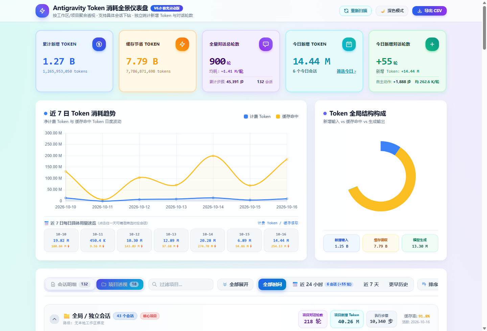
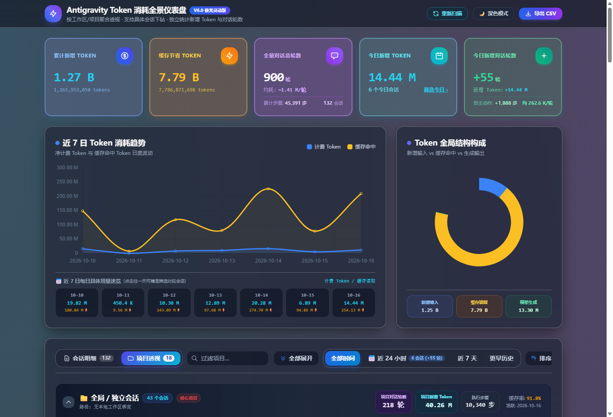
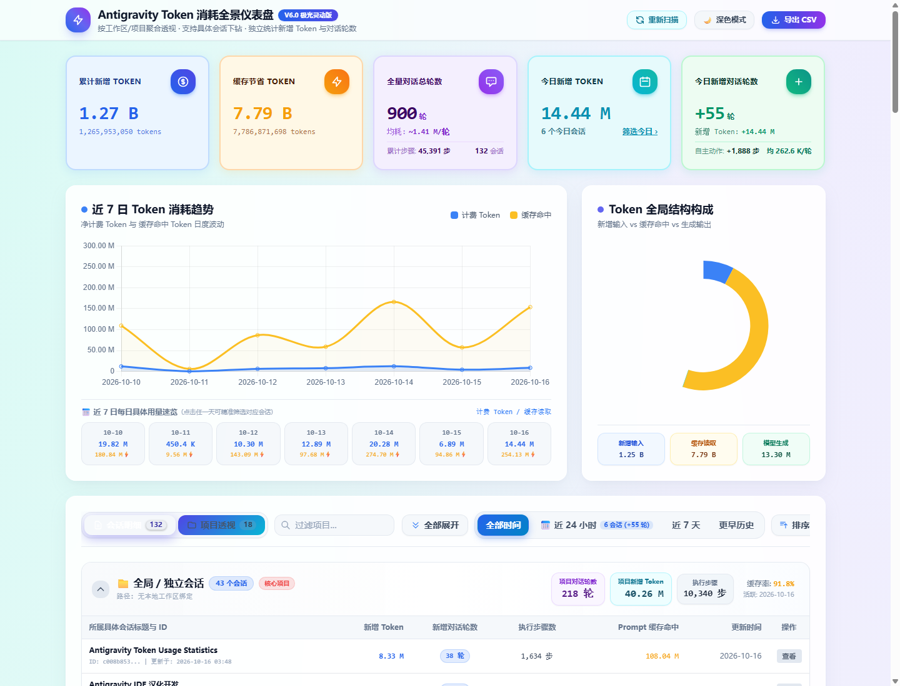
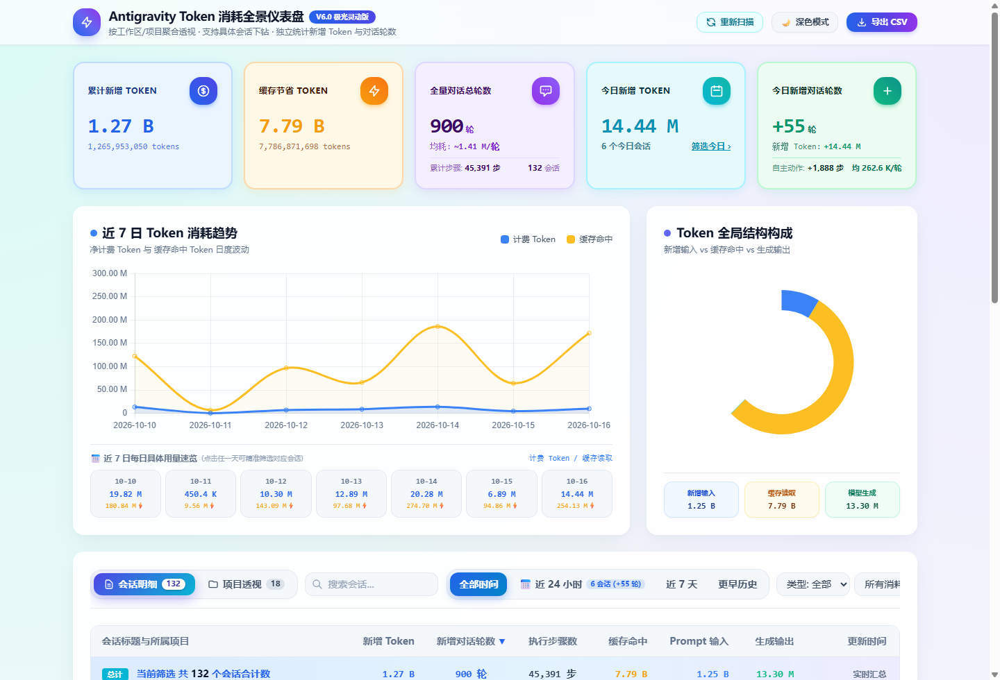

# Google Antigravity Token 消耗全景仪表盘 (Antigravity Token Dashboard)

> 专为 **Google Antigravity** 打造的高颜值、工业级交互式 Token 消耗与监控全景工作台。  
> 采用 **StudyHelp 高饱和马卡龙极光配色**，支持**工作区/项目聚合透视**与**具体会话下钻**双重视角、支持历史估算与官方实测双轨计量、单端口多路复用服务与一键秒级重新扫描。

---

## 📸 界面预览 (Screenshots)

### 1. 浅色模式全景 (Light Mode Overview)


### 2. 深色极光模式 (Dark Aurora Mode)


### 3. 项目聚合透视与具体会话下钻 (Project Perspective & Drilldown)


### 4. 会话全量明细与数据账本 (Session Detail & Ledger)


---

## ⚡ 极速使用指南 (Quick Start)

### 1. 第一次使用 (First Run)
克隆或下载本项目到本地后，直接双击运行：
👉 **`启动本地看板服务(端口8765).bat`** （或在终端执行 `python server.py`）

- 自动智能探测本地 Antigravity 会话数据目录；
- 毫秒级全量聚合会话流水，生成结构化指标；
- 自动在默认浏览器中秒开全屏看板：**`http://127.0.0.1:8765/`**。

---

### 2. 以后日常使用 (Daily Workflow)

- **日常启动**：双击 **`启动本地看板服务(端口8765).bat`** 即可秒开展开监控；
- **同步最新用量**：**无需关闭重启服务**！直接在网页右上角点击 **「重新扫描」** 按钮，后端即刻无刷新重算并平滑重绘图表与列表；
- **源文件直达**：在列表点击具体会话，自动唤醒资源管理器（或 Directory Opus）精准定位底层日志文件。

---

## 🌟 核心特性 (Key Features)

- 🎨 **StudyHelp 极光灵动视觉体系**：
  - 高饱和五色马卡龙指标卡片（累计新增、缓存节省、总轮数与均耗、今日新增 Token、今日新增轮数）；
  - 全局单行极简控制工具栏：左侧紧凑切换卡与快速过滤，右侧展开操作、时间快捷胶囊与“排序”按钮左右呼应；
  - 完美支持 **深色模式 (Dark) / 浅色模式 (Light)** 无缝切换与偏好记忆。
- 📂 **双重视角自由切换 (Dual Perspective)**：
  - **项目透视 (Project Perspective)**：按本地物理工程目录/工作区智能聚合，展示项目净计费 Token、用户提问轮数、自主步骤数与活跃时间，支持一键展开具体下钻会话；
  - **会话明细 (Session Detail)**：全量会话逐条分析，支持按会话标题、ID、所属项目模糊搜索，多维度消耗级别筛选与动态分页。
- ⏱️ **毫秒级时间增量感知**：
  - 提供 `全部时间`、`📅 近 24 小时`、`近 7 天`、`更早历史` 快捷过滤胶囊；
  - 顶部 KPI 与表格置顶总计行毫秒级联动重算，直观掌控今日用量与历史用量波动。
- 🔌 **单端口多路复用服务 (`8765`)**：
  - 采用单一稳定端口 `http://127.0.0.1:8765/`，集成静态看板托管、`/api/refresh` 动态重算接口与文件穿透定位；
  - 彻底根除浏览器缓存带来的“改完没反应”困扰。

---

## 📁 目录结构

```text
Antigravity usage/
│
├── 🌐 index.html                     # 核心全景仪表盘前端界面（纯静态无外置依赖，开箱即用）
├── 🐍 generator.py                   # 核心数据扫描与报表生成引擎（自动探测 Antigravity 目录并核算）
├── 🚀 server.py                      # 本地高性能单端口服务（支持无刷新重新扫描与会话穿透）
├── 📄 data.json                      # 扫描汇总后的全量结构化数据快照
├── 🔌 启动本地看板服务(端口8765).bat   # 本地常驻服务启动器（双击秒开）
├── 📁 docs/images/                   # 高清界面预览图
└── 📘 README.md                      # 项目说明文档
```

---

## 📊 数据核算模型与说明

- **新增计费 Token (Billed Tokens)**：
  $$\text{Billed Tokens} = \text{Input Tokens} + \text{Output Tokens}$$
  直接反映调用模型实际消耗的付费/配额消耗量。
- **缓存节省 Token (Cache Saved)**：
  统计利用上下文缓存 (Context Caching) 读取的 Token 规模，有效展示缓存机制带来的吞吐节省。
- **对话轮数 (User Turns) 与均耗**：
  以用户实际发送指令回合（User Prompt）为原子基准，严密计算每轮提问所伴随的真实 Token 均耗与自主步骤（Step Count）。

---

## 📄 开源许可证

本项目基于 [MIT License](LICENSE) 开源。
